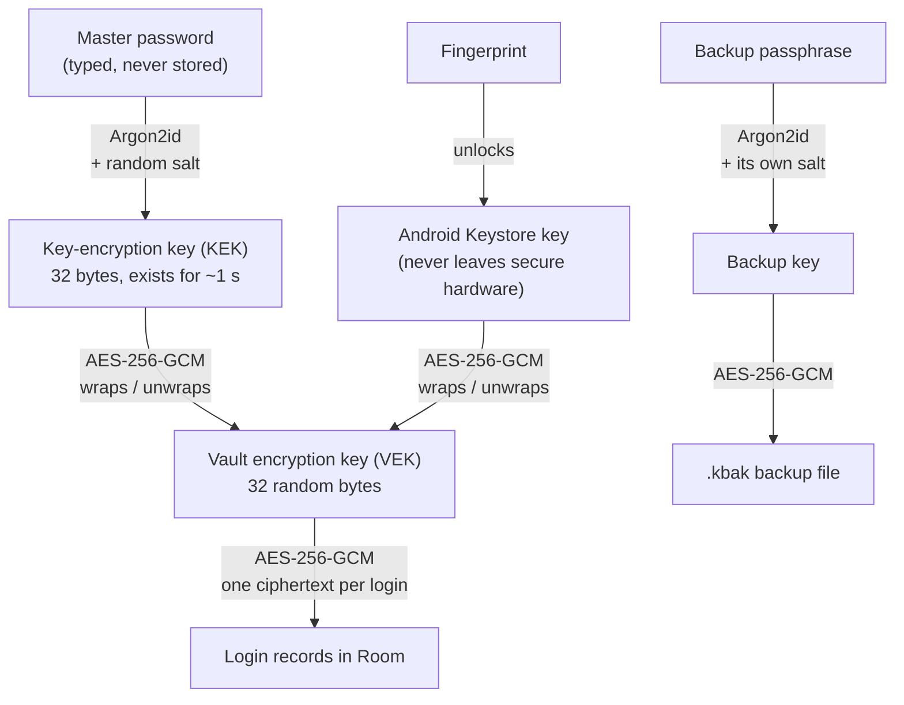
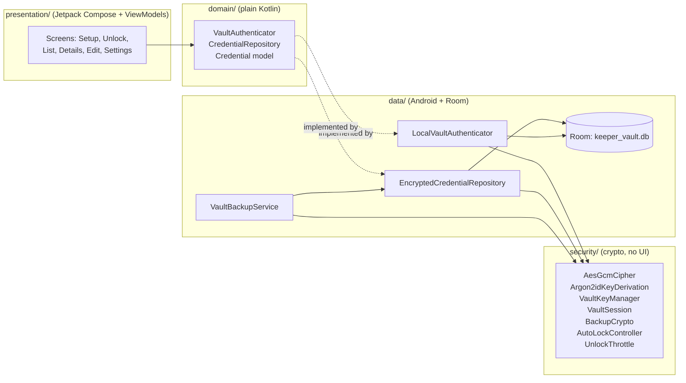
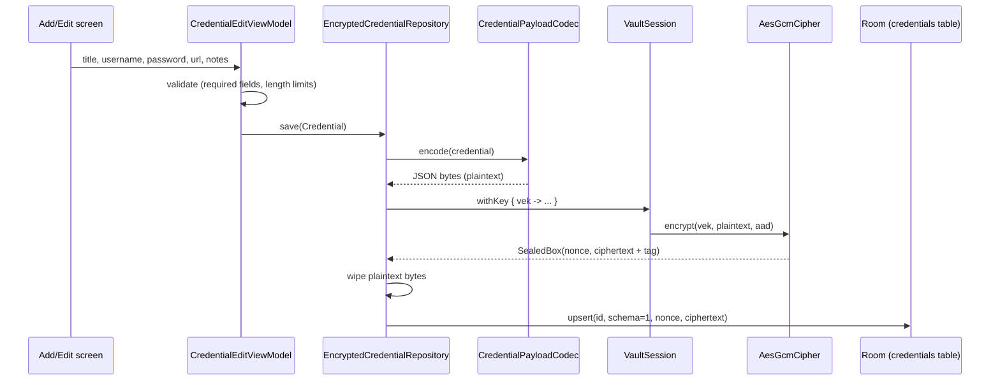
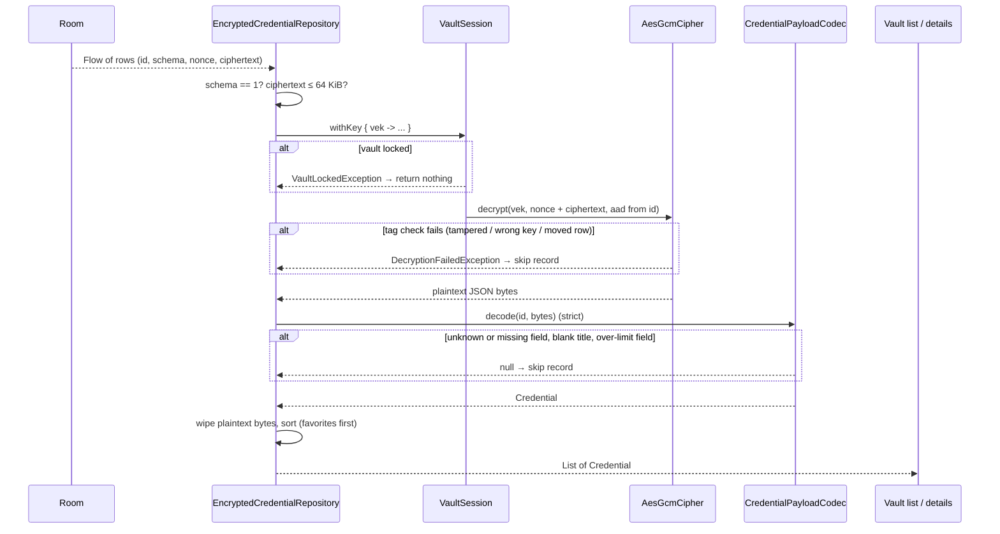
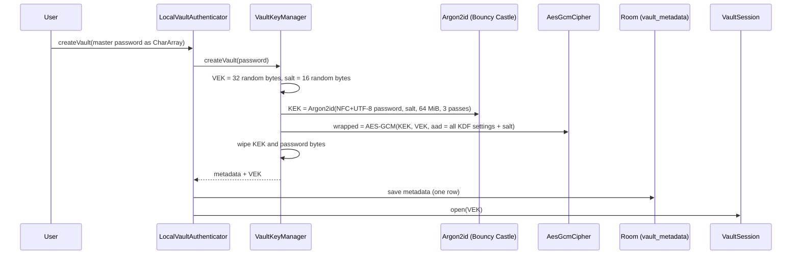

# Keeper

**An offline Android password vault, built to learn how to store sensitive data securely on
Android.**

Keeper keeps logins (title, username, password, website, notes) in an encrypted vault on the
phone. There's no account, no server and no network permission. The app exists to show, in real
working code, how a piece of plain text such as a password becomes ciphertext on disk, how it
comes back, and what Android gives you to keep it from leaking along the way.

> **This is a learning project.** It hasn't had an independent security review. Don't store real
> passwords in it. The design notes are honest about what it can't protect against (see
> [Threat model](#9-threat-model-and-limitations)).

This README goes from the outside in. Each layer adds detail to the previous one, so you can stop
at whatever depth you need.

| Layer | Section | Read it to learn |
|---|---|---|
| 1 | [The idea in one picture](#1-the-idea-in-one-picture) | Which keys exist and what each one protects |
| 2 | [The app's structure](#2-the-apps-structure) | Where each responsibility lives in the code |
| 3 | [Saving a login: plain text to database](#3-saving-a-login-plain-text-to-database) | Every step a password goes through on the way to disk, with real bytes |
| 4 | [Reading a login back](#4-reading-a-login-back-database-to-plain-text) | How it's decrypted and validated, and what happens on failure |
| 5 | [Where the vault key comes from](#5-where-the-vault-key-comes-from) | Setup, master-password unlock, and fingerprint unlock |
| 6 | [Encrypted backups](#6-encrypted-backups) | The backup file format, byte by byte |
| 7 | [Keeping secrets from leaking at runtime](#7-keeping-secrets-from-leaking-at-runtime) | Screenshots, clipboard, autofill, auto-lock, Android backup, brute force |
| 8 | [What is on the disk](#8-what-is-on-the-disk-and-how-to-check-yourself) | Every file Keeper writes, and how to inspect them with `adb` |
| 9 | [Threat model and limitations](#9-threat-model-and-limitations) | What this protects against, and what it can't |
| 10 | [Building, testing, project map](#10-building-and-testing) | How to run it and where everything is |
| 11 | [Lessons learned](#11-lessons-learned) | Things that surprised me along the way |

The full engineering notes are in [`docs/design.md`](docs/design.md), and the original
requirements are in [`docs/offline_password_manager_prd.md`](docs/offline_password_manager_prd.md).

---

## 1. The idea in one picture

Keeper never encrypts your logins with your master password directly. It uses a **key
hierarchy**:



| Key | Made from | Stored where | Lives in memory |
|---|---|---|---|
| **VEK** (vault encryption key) | 32 random bytes, generated once per vault | Only **wrapped**: encrypted by the KEK, and optionally by the Keystore key | Only while the vault is unlocked, in `VaultSession` |
| **KEK** (key-encryption key) | Argon2id(master password, salt) | Nowhere | About a second, during setup or unlock, then overwritten |
| **Keystore key** | Generated inside the Android Keystore | Inside the Keystore; the app only ever holds a handle | Never (key material can't be exported) |
| **Backup key** | Argon2id(backup passphrase, new salt) | Nowhere | During export or restore only |

**Why not just encrypt everything with a key derived from the password?** A random VEK, wrapped
by password-derived keys, has three advantages:

- **Changing the password** would only mean re-wrapping one 32-byte key, not re-encrypting
  every record.
- **A second unlock method** (the fingerprint) can wrap the same VEK independently.
- **The VEK is fully random**, so the records' security doesn't depend on how good the password
  is. Password guessing has to go through slow Argon2id instead.

---

## 2. The app's structure



- **Screens never see a key or ciphertext.** They talk to two interfaces: `VaultAuthenticator`
  (create, unlock, lock) and `CredentialRepository` (save, read, delete).
- **`security/` has no UI and almost no Android code**, so its crypto runs in plain JVM unit
  tests.
- **`VaultSession` is the single owner of the VEK.** Other code borrows it only inside
  `session.withKey { key -> … }`, and locking overwrites it with zeros.
- **Navigation follows the vault state** (`NoVault` / `Locked` / `Unlocked`). Locking replaces
  the whole back stack, so vault screens and their ViewModels are discarded and Back can't
  return to them.

Stack: Kotlin 2.2.10, Jetpack Compose (BOM 2026.02.01), Navigation Compose 2.9.8, Room 2.8.5,
AndroidX Biometric 1.1.0, Bouncy Castle 1.86 (for Argon2id only), kotlinx-serialization 1.9.0.
`minSdk` 31 (Android 12), `targetSdk` 37.

---

## 3. Saving a login: plain text to database

This is the core of the project. Here's exactly what happens when you type a login and tap
**Save**, using **real values** produced by Keeper's own code: a demo vault with the master
password `correct horse battery staple`, and a fake login.



### Step 1: the form becomes a `Credential` object (in memory only)

`CredentialEditViewModel` checks the form (title and password required, length limits such as
1,000 characters for a password) and builds a `Credential`. New logins get a random UUID as their
id.

```kotlin
Credential(
    id = "3f2a9c1e-7b4d-4e8a-9c21-5d6e7f8a9b0c",
    title = "Example Mail",
    username = "alex@example.com",
    password = "Tr0ub4dor&3",
    url = "https://mail.example.com",
    notes = "",
    favorite = false,
)
```

`Credential.toString()` is overridden to print only the id, so a stray log line or crash report
can't leak a password.

### Step 2: serialize to bytes, the plaintext

`CredentialPayloadCodec.encode()` turns every field except the id into strict JSON, then UTF-8
bytes (140 bytes here):

```json
{"title":"Example Mail","username":"alex@example.com","password":"Tr0ub4dor&3","url":"https://mail.example.com","notes":"","favorite":false}
```

**The id is deliberately not inside the payload.** It's bound to the ciphertext a different way
(step 4).

### Step 3: borrow the vault key

`VaultSession.withKey { vek -> … }` lends the 32-byte VEK for the duration of the call. If the
vault is locked there's no key, and saving throws `VaultLockedException`.

```
VEK (demo vault) = ba49acb019453f783a2e5a95d71abf0ab9c869ada192428b7ad317de555edf38
```

> Printed here only because this is a throwaway demo vault. The real app never logs, displays or
> stores the VEK in plain form.

### Step 4: encrypt with AES-256-GCM

`AesGcmCipher.encrypt(key, plaintext, associatedData)` uses the platform `javax.crypto`
implementation of `AES/GCM/NoPadding`:

| Input | Value | Why |
|---|---|---|
| Key | the VEK (32 bytes → AES-256) | |
| Nonce | **12 fresh random bytes** from `SecureRandom`, e.g. `17a46d737cc4752b3eed0392` | GCM must never reuse a nonce with the same key. The cipher picks it itself; callers can't pass one in. |
| Associated data (AAD) | `keeper/credential/v1;id=3f2a9c1e-7b4d-4e8a-9c21-5d6e7f8a9b0c` | Authenticated but not encrypted. It ties this ciphertext to this record id and schema version. |
| Tag length | 128 bits | Detects any change to the ciphertext, nonce or AAD |

Output: 140 bytes of ciphertext plus a 16-byte tag, **156 bytes**:

```
22e2473d66e7cc3ac3e85063672b90bcbe6dce480ba83bfd58c63c51ac95e2d6f46002e74f3a7ec8eabacd3f8cd10c4a
63286c681032f5f7ab473da9556d6325ff213019419a6c58fee8ba64b41de1eb9c63707e224ad1c32e97df0da88911f4
913c89569d2c6a1c12994b5560cb8561ace178ab781c5c46eadd0ae65efc56cd9eca49420b9e3dbf61820d8544b0f6a7
969a0853f180e7b688e70722
```

**What the AAD buys you:** if someone with access to the database copies record A's ciphertext
onto record B's row, decryption fails, because B's id gives different associated data. Records
can't be swapped, duplicated or moved unnoticed.

### Step 5: wipe the plaintext

The JSON byte array is overwritten with zeros in a `finally` block as soon as encryption is done.
(The JVM may still hold other copies; see [limitations](#9-threat-model-and-limitations).)

### Step 6: store the row

`CredentialDao.upsert()` writes one row to the `credentials` table:

| Column | Value | Readable without the VEK? |
|---|---|---|
| `id` | `3f2a9c1e-7b4d-4e8a-9c21-5d6e7f8a9b0c` | Yes: a random UUID, which reveals nothing |
| `payload_schema_version` | `1` | Yes |
| `nonce` | 12 bytes | Yes, and it doesn't need to be secret |
| `ciphertext` | 156 bytes | **No** |

**There is no plaintext column at all:** no title column, no username column, no search index.
Searching happens over records decrypted in memory while the vault is unlocked.

---

## 4. Reading a login back: database to plain text



1. **Room streams the rows.** The repository watches the `credentials` table as a `Flow`, so the
   list updates by itself after saves and deletes.
2. **Cheap checks first.** Rows with an unknown schema version, or with ciphertext over 64 KiB,
   are rejected before any decryption.
3. **Decrypt and verify in one step.** AES-GCM recomputes the tag over the ciphertext, the nonce
   and the AAD rebuilt from the row's id. If anything differs (a flipped bit, a row moved to
   another id, the wrong key), the result is `DecryptionFailedException`. That exception carries
   no detail, and no partial plaintext is ever returned.
4. **Strict decoding.** The JSON must have exactly the expected fields, a non-blank title, a
   non-empty password, and every field within its limit. Anything else is rejected.
5. **Wipe and return.** The plaintext bytes are zeroed, and the `Credential` goes to the UI.

**Failure handling:** a record that fails any check is left out instead of being shown half-read
("fail closed"). While the vault is locked, reads return an empty list and writes throw.

**On screen:** the details screen masks the password until you tap the eye icon, and that "shown"
state is deliberately not saved, so it resets after every recreation.

---

## 5. Where the vault key comes from

Sections 3 and 4 assumed the VEK was already in memory. This section shows how it gets there.

### 5.1 Creating a vault (first launch)



**The password is normalized first.** `MasterPasswordEncoding` applies Unicode **NFC** and then
UTF-8. This way "café" typed as one character (é) and as e plus a combining accent produce the
same bytes. Spaces are never trimmed. The same function is used for unlock and backup
passphrases.

**Argon2id settings:**

| Setting | Value |
|---|---|
| Memory | 64 MiB |
| Passes | 3 |
| Parallelism | 1 |
| Output | 32 bytes |
| Version | 0x13 |

Argon2id is deliberately slow and memory-hungry. On a Galaxy S21 FE it takes about 0.96 s, which
is fine once per unlock and very expensive for someone trying millions of guesses.

**The wrap's associated data contains every KDF setting and the salt.** From the demo vault:

```
keeper/master-wrapped-vek/v1;kdf=argon2id;v=19;m=65536;t=3;p=1;len=32;salt=a42e3e180c879b021d53aaa49b81c1bf
```

If an attacker edits the stored settings, for example lowering the memory cost so guesses are
cheaper, unwrapping fails instead of quietly deriving a different key.

**The `vault_metadata` row** (the only place the VEK is stored, and only wrapped):

| Column | Demo value |
|---|---|
| `kdf_algorithm`, `kdf_version` | `argon2id`, `19` |
| `kdf_memory_kib`, `kdf_iterations`, `kdf_parallelism`, `kdf_output_bytes` | `65536`, `3`, `1`, `32` |
| `master_salt` | `a42e3e180c879b021d53aaa49b81c1bf` |
| `wrap_algorithm` | `aes-256-gcm` |
| `master_wrapped_vek_nonce` | `910ae30fcce545ec40efd91c` |
| `master_wrapped_vek_ciphertext` | 48 bytes (32-byte VEK + 16-byte tag) |
| `biometric_*` | empty until fingerprint unlock is turned on |

Saving metadata is a single-row write, so an interrupted setup leaves either a complete vault or
none.

### 5.2 Unlocking with the master password

1. **Attempt limit first.** If too many wrong passwords were entered recently, the attempt is
   refused without checking the password ([section 7](#7-keeping-secrets-from-leaking-at-runtime)).
2. **Load and validate the metadata.** Unknown algorithms, an unknown schema, or out-of-range
   Argon2id settings are rejected before Argon2id runs, so a tampered file can't make the app
   allocate gigabytes. The accepted ranges are 19–256 MiB of memory, 2–10 passes and 1–4 lanes.
3. **Derive the KEK** from the typed password and the stored salt, on a background thread.
4. **Try to unwrap the VEK.** A wrong password produces a different KEK, the GCM tag check
   fails, and Keeper shows one generic message: "Could not unlock vault. Check your password or
   vault data." A wrong password, tampered metadata and unsupported settings all look identical
   from outside.
5. **On success,** `VaultSession.open(vek)` runs, the state becomes `Unlocked`, and the
   inactivity timer starts.

### 5.3 Unlocking with a fingerprint

Turning on biometric unlock in Settings:

1. **Create a Keystore key.** Keeper creates an AES-256-GCM key in the **Android Keystore** with:
   - `setUserAuthenticationRequired(true)` and `setUserAuthenticationParameters(0, AUTH_BIOMETRIC_STRONG)`:
     every single use needs a fresh strong (Class 3) biometric. Device PIN or pattern isn't
     accepted.
   - `setInvalidatedByBiometricEnrollment(true)`: adding or removing a fingerprint permanently
     breaks the key.
2. **Authorize a cipher.** That key's encrypt `Cipher` goes into `BiometricPrompt` as a
   **`CryptoObject`**. Only after a successful fingerprint does Android authorize that one
   cipher operation.
3. **Wrap the VEK.** The authorized cipher encrypts the VEK with associated data
   `keeper/biometric-wrapped-vek/v1;alias=<key alias>`. The Keystore picks the nonce, and Keeper
   stores the nonce and ciphertext in the `biometric_*` columns.

Unlocking with a fingerprint is the reverse. Keeper asks the Keystore for a decrypt cipher using
the stored nonce, `BiometricPrompt` authorizes it, and the authorized cipher unwraps the VEK.

**Why the `CryptoObject` matters:** many apps only check "did the prompt say success?". That's a
UI gate a modified app or an instrumentation tool can skip. With a `CryptoObject`, the key
**cannot be used at all** without a real fingerprint; Keeper's instrumented test confirms that
using the cipher without authentication throws. The key material never leaves the Keystore.

**If you add a fingerprint,** Android invalidates the key. Keeper notices, turns biometric unlock
off, tells you why, and the master password keeps working.

### 5.4 Locking

`VaultSession.close()` overwrites the VEK with zeros and drops it. The state becomes `Locked`, and
navigation replaces every vault screen with the Unlock screen.

---

## 6. Encrypted backups

**Settings → Export encrypted backup** writes a `.kbak` file through the system file picker
(Storage Access Framework). It uses a **separate backup passphrase**, not the master password, so
the backup can be restored on another phone where the fingerprint key doesn't exist.

**File format, version 1** (big-endian):

| Bytes | Field | Value |
|---|---|---|
| 8 | magic | `KEEPERBK` |
| 1 | format version | `1` |
| 1 | KDF id | `1` = Argon2id |
| 1 | KDF version | `0x13` |
| 4 | memory (KiB) | `65536` |
| 4 | iterations | `3` |
| 1 | parallelism | `1` |
| 1 | key length | `32` |
| 1 + 16 | salt length, salt | random per export |
| 1 | cipher id | `1` = AES-256-GCM |
| 1 + 12 | nonce length, nonce | random per export |
| 4 | ciphertext length | must equal the rest of the file |
| n + 16 | ciphertext + tag | encrypted JSON of all logins |

**Every header byte from the magic to the cipher id is the associated data.** Change any header
byte and the file won't decrypt. A frozen copy of a version-1 file lives in
`app/src/test/resources/backup/`, and a test checks that it still decrypts, so the format can't
change by accident.

**Restoring is defensive.** Checks run in order, and nothing in the vault changes unless all of
them pass:

1. **Size:** at most 50 MiB. The file is read with a hard cap, so a huge file is never loaded.
2. **Structure:** magic, versions, ids, nonce length, and an exact ciphertext length.
3. **Argon2id settings** within bounds, checked **before** Argon2id runs.
4. **Decryption:** a wrong passphrase and a damaged file give the same result.
5. **Every record:** at most 10,000 records, unique ids, required fields, and length limits.
6. **Re-encrypt and replace:** every record is encrypted under this phone's VEK **before**
   touching the database, then all rows are replaced in **one Room transaction**.

The backup never contains the VEK, the wrapped VEK, the Keystore key or the biometric settings.

---

## 7. Keeping secrets from leaking at runtime

Encrypting the database is only half the job; plaintext can escape in many other ways. Each row
below is a leak path and the Android feature Keeper uses against it.

| Leak path | Protection | Android API |
|---|---|---|
| Screenshots, screen recording, the recent-apps thumbnail | Blocked for the whole window | `WindowManager.LayoutParams.FLAG_SECURE` |
| Android Auto Backup / device transfer copying the database | Every storage area excluded | `android:allowBackup="false"` + `res/xml/data_extraction_rules.xml` |
| Copied password staying on the clipboard | Cleared after ~30 s, **only if** it's still Keeper's clip; marked sensitive so Android 13+ hides the preview | `ClipboardManager`, `ClipDescription.EXTRA_IS_SENSITIVE` |
| Password managers (Samsung Pass, Google) reading or saving Keeper's fields | Compose autofill turned off app-wide | `ComposeUiFlags.isSemanticAutofillEnabled = false` |
| Phone left unlocked with Keeper open | Locks **as soon as you leave Keeper**, **when the screen turns off**, and after **30 s without a touch or keystroke** | `ProcessLifecycleOwner`, `ACTION_SCREEN_OFF`, `Activity.onUserInteraction` |
| Someone guessing the master password on the device | First 4 wrong attempts free (with a warning on the 3rd and 4th), then a 30 s wait that doubles up to 3 h; survives restarts and clock changes | `SystemClock.elapsedRealtime`, `Settings.Global.BOOT_COUNT` |
| Logs and crash reports | No logging in the app; `toString()` of every secret-holding class prints no secret | n/a |
| Secrets in navigation or saved state | Routes carry only record ids; no secret goes into `SavedStateHandle` or `rememberSaveable` | n/a |
| Network | No `INTERNET` permission at all | `AndroidManifest.xml` |

**Two details worth noting:**
- **The system screens Keeper opens itself** (the fingerprint prompt and the backup file picker)
  pause the auto-lock rules, otherwise turning on biometrics or exporting a backup would lock
  the vault mid-way. Screen-off still locks during them.
- **During an attempt-limit wait, the password isn't checked at all**, so no Argon2id runs and
  nothing is learned. A fingerprint unlock still works and resets the count.

---

## 8. What is on the disk, and how to check yourself

Everything lives in the app's private folder, `/data/data/io.github.rahulraj94391.keeper/`.

| File | Contents | Secret? |
|---|---|---|
| `databases/keeper_vault.db` (+ `-wal`, `-shm`) | `vault_metadata` (1 row: KDF settings, salt, wrapped VEK, biometric wrap) and `credentials` (id, schema, nonce, ciphertext) | No plaintext. Readable values are salts, nonces, settings and UUIDs. |
| `shared_prefs/keeper_unlock_throttle.xml` | Wrong-attempt count and lockout timing | No |
| Android Keystore (not a file in the app folder) | The biometric wrapping key | Never exportable |

**Inspect it yourself on a debug build** (`run-as` only works for debuggable apps):

```bash
adb exec-out run-as io.github.rahulraj94391.keeper cat databases/keeper_vault.db > keeper_vault.db
```

```bash
adb exec-out run-as io.github.rahulraj94391.keeper cat databases/keeper_vault.db-wal > keeper_vault.db-wal
```

```bash
sqlite3 keeper_vault.db "select id, payload_schema_version, length(nonce), length(ciphertext) from credentials;"
```

```bash
grep -a -c "your-test-password" keeper_vault.db keeper_vault.db-wal
```

On the test phone, searching the database, WAL and SHM files gave **0 matches** for every value
checked: a test login's title, username and password, the master password, and (in a 41-login
vault) the sample titles, usernames and domains.

**Confirm Android backup is refused:**

```bash
adb shell bmgr backupnow io.github.rahulraj94391.keeper
```

---

## 9. Threat model and limitations

**Keeper protects against:**
- Someone copying the app's database or files while the vault is locked.
- Someone with a backup file but not its passphrase.
- Accidental plaintext in logs, screenshots, the recent-apps preview, the clipboard (after
  ~30 s), Android backup, or other password managers.
- Tampering with records, metadata or backup files (detected, never silently accepted).
- Guessing the master password on the device's own Unlock screen (rate-limited).

**It cannot protect against:**
- **A rooted or compromised phone, or malware inside the app while it's unlocked.** Code running
  with that access can read memory or call the app's own functions.
- **Offline guessing** if someone copies the vault file and you chose a weak master password.
  Argon2id makes each guess slow, but can't make a weak password strong.
- **Keyloggers, malicious keyboards, or someone watching your screen.** Keyboard apps may also
  keep their own history of what you typed.
- **Perfect memory wiping.** Byte arrays are zeroed after use, but the JVM can copy them, Kotlin
  `String`s can't be wiped, and the crypto provider keeps internal copies.
- **Physical erasure.** Deleting a login deletes the row, but flash storage and SQLite pages may
  keep old data.
- **Hardware backing.** Whether the Keystore key is backed by secure hardware depends on the
  phone; Keeper doesn't check or claim it.

**Project limitations:** it isn't independently audited, and it's not meant for real passwords.
Records that fail decryption are skipped without a warning.

---

## 10. Building and testing

Requirements: a recent Android Studio (the Gradle daemon is pinned to JDK 25 in
`gradle/gradle-daemon-jvm.properties`), and a device or emulator running Android 12 (API 31) or
later.

```bash
./gradlew assembleDebug
```

```bash
./gradlew testDebugUnitTest
```

```bash
./gradlew connectedDebugAndroidTest
```

- **Unit tests** (about 180): AES-GCM tampering cases, Argon2id against the RFC 9106 and
  reference-implementation test vectors, key wrapping, the session, the record codec, the
  encrypted repository, the backup format (including a frozen fixture and hostile inputs),
  auto-lock and attempt-limit timing with virtual clocks, and every ViewModel.
- **Instrumented tests** (12): real Room storage with a raw-dump "no plaintext" check, the
  schema migration, the real Keystore key refusing to work without authentication (skipped if no
  fingerprint is enrolled), `FLAG_SECURE`, the autofill opt-out, and an Argon2id timing benchmark.
- **Debug builds** have **Settings → Developer → Add 40 sample logins** for trying the UI with
  fake data. Release builds don't include it.

### Project map

```
app/src/main/java/io/github/rahulraj94391/keeper/
├── security/        Crypto and security logic (no UI)
│   ├── AeadCipher.kt                 AES-256-GCM, random nonces, opaque failures
│   ├── KeyDerivation.kt              Argon2id + parameter bounds
│   ├── MasterPasswordEncoding.kt     NFC + UTF-8 password encoding
│   ├── VaultKeyManager.kt            Creates, wraps and unwraps the VEK
│   ├── VaultSession.kt               The only holder of the VEK while unlocked
│   ├── BiometricKeyStore.kt          Android Keystore key + biometric wrapping
│   ├── BackupCrypto.kt               .kbak format: write and defensive read
│   ├── AutoLockController.kt         Leave / screen-off / 30 s idle locking
│   ├── UnlockThrottle.kt             Wrong-password backoff
│   ├── ClipboardGuard.kt             30 s clipboard clearing
│   └── PasswordGenerator.kt          SecureRandom password generator
├── data/
│   ├── local/                        Room entities, DAOs, database
│   ├── repository/                   EncryptedCredentialRepository, CredentialPayloadCodec
│   ├── auth/                         LocalVaultAuthenticator, throttle storage, biometric checks
│   ├── vault/                        Room-backed vault metadata store
│   └── backup/                       Export/restore through the system file picker
├── domain/          Plain Kotlin models and interfaces
├── presentation/    Compose screens and ViewModels
└── di/AppContainer.kt                Manual dependency wiring
```

---

## 11. Lessons learned

- **Use a CryptoObject, or biometrics are just a UI check.** A success callback alone proves
  nothing to the cryptography.
- **Associated data is underrated.** Binding the record id into each ciphertext, and the KDF
  settings into the key wrap, turns "swap these bytes" attacks into hard failures with no extra
  storage.
- **Never let callers choose GCM nonces.** Keeper's cipher API has no nonce parameter, so nonce
  reuse can't happen through it.
- **Validate before expensive work.** Reject hostile Argon2id settings and oversized files
  **before** running the KDF, or a tiny malicious file becomes a denial-of-service attack.
- **Encrypting the database isn't enough.** Screenshots, the clipboard, Auto Backup, autofill
  services and logs all leak plaintext unless you close them one by one.
- **Compose has no per-field autofill opt-out** (as of Compose 1.10). Neither semantics nor
  `View.importantForAutofill` stopped Samsung Pass; only the global
  `ComposeUiFlags.isSemanticAutofillEnabled` flag did. Counting requests with
  `adb shell dumpsys autofill` was how I found out.
- **Rate limits need a trustworthy clock.** Wall-clock time can be changed by the user, and
  `elapsedRealtime` resets on reboot, so the attempt limit uses both.
- **Write state before revealing the result.** The wrong-attempt counter is saved synchronously
  before the UI learns the password was wrong, so killing the app can't erase a failure.
- **Freeze your file format with a fixture.** One frozen test file catches accidental format
  changes forever.
